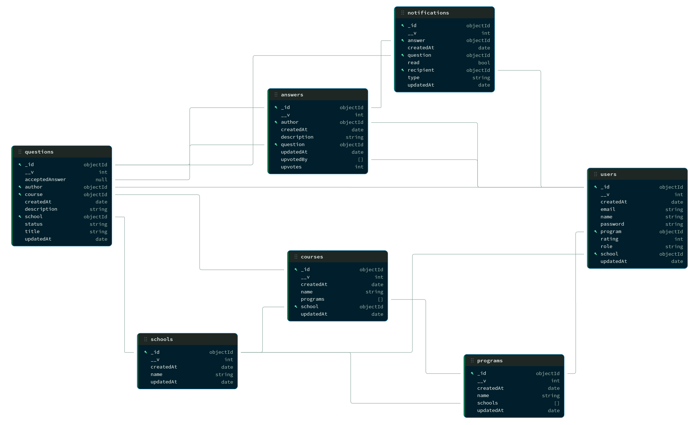

# Database

MongoDB (shared Atlas cluster) through Mongoose. All collections have `_id`, `createdAt` and `updatedAt`. Reseed with `npm run initdb -- --yes` (wipes everything).

## Relations

- **schools ↔ programs:** many-to-many (`programs.schools`). A program is one shared entry offered by several schools.
- **courses → school**, **courses ↔ programs:** a course belongs to one school and can be part of several programs.
- **users → school + program:** the program must be offered by the user's school.
- **questions → course + author:** `school` is copied from the course for filtering.
- **answers → question + author**
- **notifications → recipient + question + answer:** sent to a question's author when it gets an answer.

## Constraints

- `users.email` is unique; `users.password` is bcrypt-hashed and never returned.
- `users.role`: `student` (default), `teacher`, `moderator`.
- `questions.status`: `unanswered` (default), `answered`.
- `schools.name` and `programs.name` are unique; course names are unique per school.
- `rating`, `upvotes`, `upvotedBy`, `acceptedAnswer` and the `upvote`/`accepted` notification types are reserved for planned features.
- Deleting a question also deletes its answers.
